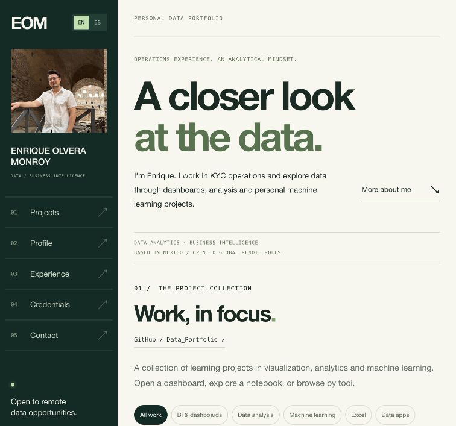

# Enrique Olvera Monroy — Professional Data Portfolio

A bilingual professional portfolio showcasing my background in KYC operations, Business Intelligence education, and personal projects in data analysis, dashboards and machine learning. The website connects my operational experience with my interest in remote data opportunities worldwide from Mexico.

The interface opens in English and includes a Spanish language option.

[Data project repository](https://github.com/EnriqueOlveraMonroy/Data_Portfolio) · [LinkedIn](https://www.linkedin.com/in/enrique-olvera-monroy) · [Guía de publicación en español](GUIA_GITHUB_PAGES.md)



## About this repository

This repository contains the portfolio website: its layout, bilingual content, images and browser interactions. The analytical project files are linked from their respective GitHub repositories.

The visual direction is minimal and editorial, using dark forest green, mint and cream. A profile sidebar on desktop becomes compact navigation on mobile. Projects are the main focus, followed by the professional profile, experience, education and contact information.

## Features

- Eleven projects organized with category filters: BI dashboards, data analysis, machine learning, Excel and data apps.
- Power BI and Tableau dashboard screenshots.
- Excel sales dashboards in English and Spanish.
- Northwestern Apartment Price Analysis and Tu Lado B website previews, with links to the live applications and source code.
- Six original vector covers for notebook and modeling projects.
- Image previews with zoom, Escape dismissal and focus return.
- English/Spanish switching with a locally remembered preference.
- Expandable work history, education and DataCamp certification.
- Downloadable English CV, LinkedIn, GitHub and email links.
- Responsive layout, keyboard focus states, accessible image descriptions and reduced-motion support.

## Technology

| Layer | Implementation |
| --- | --- |
| Structure and content | Semantic HTML5 |
| Design and responsiveness | CSS Grid, Flexbox and media queries |
| Interactions | Vanilla JavaScript |
| Visual assets | PNG, JPEG and SVG |
| Language preference | Browser localStorage |
| Hosting | Static hosting, ready for GitHub Pages |

No package installation, build command, database, API key or application server is required. The repository has no external JavaScript libraries, fonts or analytics. The site uses section anchors rather than separate application routes.

## Project structure

```text
.
├── index.html              # Initial content, navigation and page structure
├── styles.css              # Visual identity and responsive layout
├── app.js                  # Translations, filters, previews and navigation
├── assets/
│   ├── covers/             # Six project-specific SVG illustrations
│   ├── enrique-olvera.jpeg  # Portrait
│   ├── enrique-olvera-cv.pdf
│   └── ...                 # Dashboard screenshots, web previews and certificate
├── docs/
│   └── preview.png         # README preview
├── README.md
├── GUIA_GITHUB_PAGES.md     # Complete deployment guide in Spanish
├── .nojekyll               # Serve the prepared static files
└── .gitignore
```

## Run locally

Open `index.html` in a browser for a quick preview. For a local HTTP preview, run the following from this repository's directory if Python 3 is installed:

```sh
python3 -m http.server 8000 --bind 127.0.0.1
```

Then visit [the local preview](http://127.0.0.1:8000/). Stop the local server with `Ctrl+C`.

Python is only an optional preview tool; it is not part of the website runtime.

## Deploy to GitHub Pages

Upload the contents of this repository to GitHub, with `index.html` at the repository root. In **Settings → Pages**, select **Deploy from a branch**, then **main** and **/(root)**, and save. Keep the included `.nojekyll` file at the root. See the [official publishing-source guide](https://docs.github.com/en/pages/getting-started-with-github-pages/configuring-a-publishing-source-for-your-github-pages-site).

The package supports both a user website and a project website because its local resource paths are relative. The [Spanish deployment guide](GUIA_GITHUB_PAGES.md) covers repository creation, upload, activation, updates and troubleshooting.

The Northwestern and Tu Lado B applications remain on their existing hosting services. GitHub Pages hosts this portfolio and links to those applications.

## Update the portfolio

| Change | Files to update |
| --- | --- |
| English page copy, professional details and links | `index.html` |
| Spanish translations and image-preview text | `app.js` |
| Notebook project descriptions and links | `portfolioProjects` in `app.js` and the initial directory in `index.html` |
| Colors, typography and layout | `styles.css` |
| Dashboard screenshots, portrait, certificate or CV | Corresponding files in `assets/` |

Keep filenames and capitalization consistent. If replacing an asset with a differently named file, update its references in both HTML and JavaScript where applicable. Preserve the `assets/covers/` folder structure.

## Español

Portafolio profesional de Enrique Olvera Monroy orientado a oportunidades remotas en datos. Reúne experiencia laboral, formación, proyectos de análisis, dashboards y aplicaciones web personales. El sitio conserva una estética minimalista y editorial y permite cambiar entre inglés y español.

Para publicarlo sin usar la terminal, sigue la [guía completa de GitHub Pages](GUIA_GITHUB_PAGES.md).

## Author

**Enrique Olvera Monroy**  
[GitHub](https://github.com/EnriqueOlveraMonroy) · [LinkedIn](https://www.linkedin.com/in/enrique-olvera-monroy)
